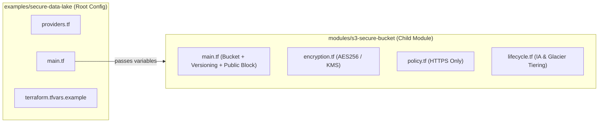

# AWS S3 Secure Bucket with Terraform

## 1. Introduction

I built this project to learn **Infrastructure as Code (IaC)** with Terraform and understand how an AWS S3 bucket is configured for real world use.

When you create an S3 bucket manually in the AWS Console for the first time, it is easy to click through the defaults without thinking about how files are encrypted in transit, what happens if someone accidentally overwrites an important file, or how storage costs add up as files get older. Writing the infrastructure in Terraform forced and helped me to understand each of these settings individually and package them into a reusable module.

---

## 2. Repository Structure & What Each File Does

```text
aws-terraform-s3/
├── .github/
│   └── workflows/
│       └── terraform-ci.yml         # Runs 'terraform fmt' and 'validate' on every push
├── modules/
│   └── s3-secure-bucket/            # Reusable S3 module (the building block)
│       ├── main.tf                  # Base bucket, public access block, and versioning
│       ├── encryption.tf            # Server-side encryption at rest (SSE-S3 / KMS)
│       ├── policy.tf                # Bucket policy denying plain HTTP (enforces HTTPS/TLS)
│       ├── lifecycle.tf             # Rules to move older files to cheaper storage tiers
│       ├── variables.tf             # Input variables with types, defaults, and validations
│       └── outputs.tf               # Exports bucket ID, ARN, domain name, and region
├── examples/
│   └── secure-data-lake/            # Real-life scenario calling the reusable module
│       ├── providers.tf             # AWS provider setup (supports AWS or local LocalStack)
│       ├── main.tf                  # Calls 'modules/s3-secure-bucket' with data lake settings
│       ├── variables.tf             # Input variables for the example environment
│       ├── terraform.tfvars.example # Template showing how variable values are passed
│       └── outputs.tf               # Prints bucket details after deployment
├── instructions/
│   └── SETUP.md                     # Local setup and command reference
├── .gitignore                       # Prevents committing .terraform/, .tfstate, and .tfvars
├── .tflint.hcl                      # Static linter rules for Terraform
└── LICENSE
```



### Why the Repository Is Divided into `modules/` and `examples/`
* **`modules/s3-secure-bucket/`**: A Terraform module is like a reusable function in programming. It defines *what* resources make up a secure S3 bucket, takes parameters through `variables.tf`, and returns useful attributes (like the bucket ARN) through `outputs.tf`. On its own, a module does not deploy anything until something calls it.
* **`examples/secure-data-lake/`**: This is the root configuration that actually calls the module for a realistic scenario—a **Data Lake bucket** where raw daily application logs and CSV exports are stored, kept in standard storage for 30 days of active queries, and then automatically moved to cheaper archive storage as they age.

---

## 3. Key Design Decisions & Rationale

1. **Splitting S3 Settings into Dedicated Resources (AWS Provider v5)**
   - In older Terraform tutorials (AWS Provider v3), settings like versioning, encryption, and lifecycle rules were written as nested blocks *inside* `aws_s3_bucket`. Starting in v4+, HashiCorp deprecated inline blocks because changing one small rule could cause state conflicts across the entire bucket. Here, every feature (`aws_s3_bucket_versioning`, `aws_s3_bucket_public_access_block`, `aws_s3_bucket_server_side_encryption_configuration`, `aws_s3_bucket_lifecycle_configuration`, and `aws_s3_bucket_policy`) is an independent resource linked by `bucket = aws_s3_bucket.this.id`.
2. **Splitting the Module into Small `.tf` Files**
   - Because Terraform automatically loads every `.tf` file in a folder together, I split `encryption.tf`, `policy.tf`, and `lifecycle.tf` out of `main.tf`. Keeping each file around 30–50 lines makes the code much easier to read and debug than one long file.
3. **Security by Default (At Rest, In Transit, and Public Access)**
   - **Public Access Block (`main.tf`)**: Enables all four AWS public access blocks (`block_public_acls`, `block_public_policy`, `ignore_public_acls`, `restrict_public_buckets`) so files cannot be accidentally exposed to the public internet.
   - **Encryption at Rest (`encryption.tf`)**: Defaults to `AES256` (SSE-S3, which AWS provides at no extra cost) with an option to pass a KMS key (`aws:kms`), and enables `bucket_key_enabled = true` to reduce KMS API calls.
   - **Encryption in Transit (`policy.tf`)**: Uses `data "aws_iam_policy_document"` to attach a bucket policy that explicitly denies (`Effect = "Deny"`) any S3 request where `aws:SecureTransport` is `false`, forcing all uploads and downloads to use HTTPS/TLS.
4. **Data Recovery & Cost Control (`main.tf` & `lifecycle.tf`)**
   - **Versioning**: Enabled by default so accidental deletes or overwrites only create a new version instead of permanently losing data.
   - **Lifecycle Rules**: Because versioning keeps old copies of files forever by default, storage bills can grow silently. `lifecycle.tf` moves active files to `STANDARD_IA` after 30 days and `GLACIER` after 90 days, deletes old overwritten (`noncurrent`) versions after 90 days, and cleans up stuck multipart uploads after 7 days.

---

## 4. What I Learned Building This Project

### Understanding HCL and Terraform Mechanics
* **Declarative vs Imperative**: In HCL (HashiCorp Configuration Language), I don't write step-by-step scripts saying *"first create this, then update that"*. Instead, I declare the desired end state, and Terraform figures out the dependency graph (and when needed, I can add explicit ordering like `depends_on = [aws_s3_bucket_public_access_block.this]` on the bucket policy to avoid AWS API race conditions).
* **Input Validation & Type Safety**: Writing `type` definitions and `validation` blocks inside `variables.tf` (such as verifying `environment` is `dev`, `staging`, or `prod`) taught me how to catch configuration mistakes immediately on my machine before Terraform ever talks to AWS.
* **Protecting State and Secrets (`.gitignore`)**: Terraform tracks managed infrastructure in a `.tfstate` file, which can contain plain text metadata and sensitive values. I learned why `.terraform/`, `*.tfstate`, and real `*.tfvars` files must always be ignored in Git, while a safe `terraform.tfvars.example` template is committed for documentation.

### Understanding the Terraform CLI Workflow
Working through this project helped me understand what each Terraform command actually does under the hood:
* **`terraform init`**: Reads the `required_providers` block, downloads the `hashicorp/aws` provider plugin into `.terraform/`, and wires up local child modules (like `../../modules/s3-secure-bucket`). *Passing `-backend=false` lets me initialize and test syntax locally without configuring a remote state backend.*
* **`terraform fmt -check -recursive`**: Automatically formats (or checks) all `.tf` files so indentation and alignment stay consistent across the whole repository.
* **`terraform validate`**: Parses the HCL files, checks that all variable references, resource attributes, and data sources match the AWS provider schema, and verifies everything offline—without needing an active AWS account or internet connection.
* **`terraform plan`**: Compares the desired HCL code against the current state and prints a preview of what will be created, modified, or destroyed.
* **`terraform apply` & `terraform destroy`**: Executes the planned API calls to create the resources (or tear them down cleanly during testing so no cloud charges are left running).

---

## 5. How to Validate & Run Locally

For full setup details (including optional local testing with Docker and **LocalStack**), see **[instructions/SETUP.md](instructions/SETUP.md)**.

To run the formatting and syntax checks locally:

```powershell
# 1. Check HCL formatting across the repo
terraform fmt -check -recursive

# 2. Initialize and validate the reusable module
terraform -chdir=modules/s3-secure-bucket init -backend=false
terraform -chdir=modules/s3-secure-bucket validate

# 3. Initialize and validate the data lake example
terraform -chdir=examples/secure-data-lake init -backend=false
terraform -chdir=examples/secure-data-lake validate
```
